# React and MCP App flow diagrams

Quick-reference diagrams extracted from `REACT_README.md`.

## Consolidated comprehensive flow

This diagram combines application startup, the MCP Apps handshake, tool execution, event timing, result validation,
React state changes, and every resulting UI state.

```mermaid
flowchart TD
    subgraph startup["1. Browser and React startup"]
        A["Browser loads index.html"] --> B["App.jsx finds the #root element"]
        B --> B1["React createRoot(...)"]
        B1 --> C["React mounts CustomerApp"]
        C --> D["Initialize state<br/>customer = null<br/>resultError = null"]
        D --> E["First render"]
    end

    subgraph setup["2. MCP App setup before connection"]
        F["useApp creates the App object"] --> G["onAppCreated receives the App"]
        G --> H["Register the toolresult listener"]
        H --> I["useApp calls app.connect()"]
    end

    subgraph handshake["3. UI-to-host connection handshake"]
        I --> J0["React renders<br/>Connecting to host..."]
        I --> J["Connect PostMessageTransport"]
        J --> K["UI sends ui/initialize"]
        K --> L["Host returns capabilities and context"]
        L --> M["UI sends initialized notification"]
        M --> N{"Connection succeeds?"}
    end

    E --> F
    N -- "No" --> O["Store connection error"]
    O --> P["React renders<br/>Connection error"]
    N -- "Yes" --> Q["App is connected"]
    Q --> R["React renders<br/>Waiting for customer..."]

    subgraph execution["4. MCP tool execution"]
        Q --> S["Host uses the MCP Client <br/> to call the MCP Server and run the tool."]
        S --> T["MCP server executes the tool"]
        T --> U["Server returns structuredContent"]
        U --> V["Host sends a toolresult event<br/>to the MCP App iframe"]
    end

    subgraph handling["5. Event timing and result handling"]
        V --> W{"Was the listener registered<br/>before connection?"}
        W -- "No: risky order" --> X["Initial result is missed"]
        X --> R
        W -- "Yes: safe order" --> Y["Listener receives result"]
        Y --> Z{"result.isError?"}
        Z -- "Yes" --> AA["setResultError:<br/>The tool call failed"]
        Z -- "No" --> AB["Read result.structuredContent"]
        AB --> AC{"Required UI fields valid?"}
        AC -- "No" --> AD["setResultError:<br/> structuredContent has missing fields"]
        AC -- "Yes" --> AE["Clear resultError"]
        AE --> AF["setState(data)"]
    end

    subgraph rendering["6. React state update and final UI"]
        AA --> AG["React re-renders"]
        AD --> AG
        AG --> AH["Render result error alert"]
        AF --> AI["React re-renders CustomerApp"]
        AI --> AJ["Render UI fields:<br/>Ex: name, company, email, status"]
    end
```

### Covered use cases

- Initial page and React startup
- MCP App creation and safe listener registration
- UI-to-host connection handshake
- Connection-pending UI
- Connection failure
- Connected UI waiting for a result
- Host-to-server tool execution and result delivery
- Correct listener timing and the missed-event risk
- Tool-reported failure
- Missing or invalid `structuredContent`
- Valid result, React state update, and successful customer display
