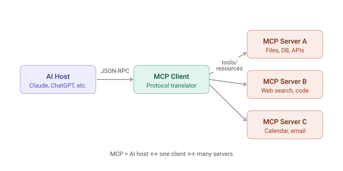

# MCP Chunk 1

### [Prompt](../attachments/_01-mcp-chunk1_prompt_for_learning_mcp.md)




---


================================================================================
CHUNK 1 / 8   |   SECTIONS: §00 · §01 · §02
TOPIC: MCP (Model Context Protocol)
================================================================================

## CHUNK TRACKER
```
┌───────┬───────────────────┬────────────┐
│ Chunk │ Sections          │ Status     │
├───────┼───────────────────┼────────────┤
│   1   │ §00 – §02         │ ← ACTIVE   │
│   2   │ §03 – §04         │ pending    │
│   3   │ §05 – §06         │ pending    │
│   4   │ §07               │ pending    │
│   5   │ §08 – §10         │ pending    │
│   6   │ §11 – §13         │ pending    │
│   7   │ §14 – §16         │ pending    │
│   8   │ §17 – §18         │ pending    │
└───────┴───────────────────┴────────────┘
```
================================================================================
## §00 · PREREQUISITES
================================================================================

### Required knowledge
```
┌─────────────────────────────┬─────────────────┐
│ Concept                     │ Level needed    │
├─────────────────────────────┼─────────────────┤
│ Python basics (funcs, async)│ Beginner        │
│ REST APIs / HTTP            │ Intermediate    │
│ JSON format                 │ Beginner        │
│ Docker basics               │ Beginner        │
│ LLMs (what they are)        │ Beginner        │
└─────────────────────────────┴─────────────────┘
```
### If you are missing any of the above, study first:

1. Python async/await — needed to run MCP tools concurrently.
2. HTTP + REST APIs — MCP is a protocol built on top of these.
3. Docker — all code in this tutorial runs in containers.

### Time estimate

- Beginner → working prototype : ~4–6 hours
- Prototype → enterprise-ready : ~2–3 days


## §01 · DEFINE


**MCP** (Model Context Protocol) is an open standard that lets an
**AI host** (an LLM app) connect to external tools and data sources
via a common interface. It removes the need to write custom
integration code for every tool.

---

### Key terms
```
┌──────────────────────┬─────────────────────────────┬────────────────────────┐
│ Term                 │ Definition                  │ Why it matters         │
├──────────────────────┼─────────────────────────────┼────────────────────────┤
│ MCP                  │ Model Context Protocol —    │ One standard replaces  │
│                      │ open standard for AI↔tool   │ N custom integrations  │
│                      │ communication               │                        │
├──────────────────────┼─────────────────────────────┼────────────────────────┤
│ AI Host              │ The LLM application that    │ Initiates all tool     │
│                      │ sends requests (e.g. Claude)│ calls                  │
├──────────────────────┼─────────────────────────────┼────────────────────────┤
│ MCP Client           │ Layer inside the host that  │ Translates host        │
│                      │ speaks the MCP protocol     │ requests into MCP msgs │
├──────────────────────┼─────────────────────────────┼────────────────────────┤
│ MCP Server           │ Process that exposes tools/ │ Wraps real systems     │
│                      │ resources over MCP          │ (DB, files, APIs)      │
├──────────────────────┼─────────────────────────────┼────────────────────────┤
│ Tool                 │ A callable function exposed │ AI can execute actions │
│                      │ by an MCP server            │                        │
├──────────────────────┼─────────────────────────────┼────────────────────────┤
│ Resource             │ A readable data source      │ AI can read files,     │
│                      │ exposed by an MCP server    │ DB rows, docs          │
├──────────────────────┼─────────────────────────────┼────────────────────────┤
│ JSON-RPC             │ A lightweight protocol that │ All MCP messages use   │
│                      │ sends function calls as JSON│ this wire format       │
├──────────────────────┼─────────────────────────────┼────────────────────────┤
│ Transport            │ How messages physically     │ Supports stdio, HTTP,  │
│                      │ travel between client/server│ WebSocket              │
└──────────────────────┴─────────────────────────────┴────────────────────────┘
```
---

🔑 Jargon:
  - **MCP**       — Model Context Protocol
  - **AI Host**   — the LLM app (e.g., Claude Desktop, your FastAPI app)
  - **MCP Client**— protocol layer inside the host
  - **MCP Server**— process exposing tools/resources
  - **Tool**      — callable function in an MCP server
  - **Resource**  — readable data in an MCP server
  - **JSON-RPC**  — the wire format MCP uses
  - **Transport** — physical delivery method (stdio / HTTP / WS)

================================================================================
## §02 · WHY IT MATTERS
================================================================================

### The problem MCP solves

Without MCP, every AI app writes its own custom connector for every
external system. With MCP, one standard interface covers all of them.

```
Before MCP:
  Claude ──custom code──► GitHub
  Claude ──custom code──► Postgres
  Claude ──custom code──► Slack
  (N tools = N integrations)

After MCP:
  Claude ──MCP──► MCP Server (GitHub)
  Claude ──MCP──► MCP Server (Postgres)
  Claude ──MCP──► MCP Server (Slack)
  (N tools = 1 protocol, N servers)
```

---

### Industry usage
```
┌─────────────────────────┬─────────────────────┬─────────────────────────────┐
│ Use Case                │ Industry            │ Problem it solves           │
├─────────────────────────┼─────────────────────┼─────────────────────────────┤
│ AI coding assistant     │ Software dev        │ Agent reads/writes files,   │
│ reads your codebase     │                     │ runs tests via MCP          │
├─────────────────────────┼─────────────────────┼─────────────────────────────┤
│ AI analyst queries live │ Finance / Analytics │ LLM accesses DB without     │
│ databases               │                     │ storing credentials itself  │
├─────────────────────────┼─────────────────────┼─────────────────────────────┤
│ AI support agent reads  │ Customer support    │ Agent pulls live ticket      │
│ your ticketing system   │                     │ data, no hard-coded API keys │
└─────────────────────────┴─────────────────────┴─────────────────────────────┘
```
---

### 3 Concrete use cases

1. **Coding agent** — Claude reads your local file system, edits
   code, and runs shell commands — all via MCP servers.

2. **Data analyst agent** — LLM queries a PostgreSQL database in
   real time. The MCP server enforces read-only access.

3. **Enterprise search agent** — AI searches Confluence, Jira, and
   Slack simultaneously via separate MCP servers, returns a
   unified answer.

================================================================================
## 🔑 JARGON SUMMARY — CHUNK 1
================================================================================
```
┌────────────────┬───────────────────────────────────────────────────────┐
│ Term           │ One-line reminder                                     │
├────────────────┼───────────────────────────────────────────────────────┤
│ MCP            │ Open standard for AI ↔ tool communication            │
│ AI Host        │ The LLM application that initiates calls             │
│ MCP Client     │ Protocol layer inside the host                       │
│ MCP Server     │ Process that wraps external tools/data               │
│ Tool           │ Callable function exposed over MCP                   │
│ Resource       │ Readable data (file, DB row) exposed over MCP        │
│ JSON-RPC       │ Wire format: function calls sent as JSON             │
│ Transport      │ Delivery method: stdio, HTTP/SSE, WebSocket          │
└────────────────┴───────────────────────────────────────────────────────┘
```
================================================================================

NEXT: Reply "chunk 2" to continue → §03 Core Concepts + §04 How It Works

================================================================================
