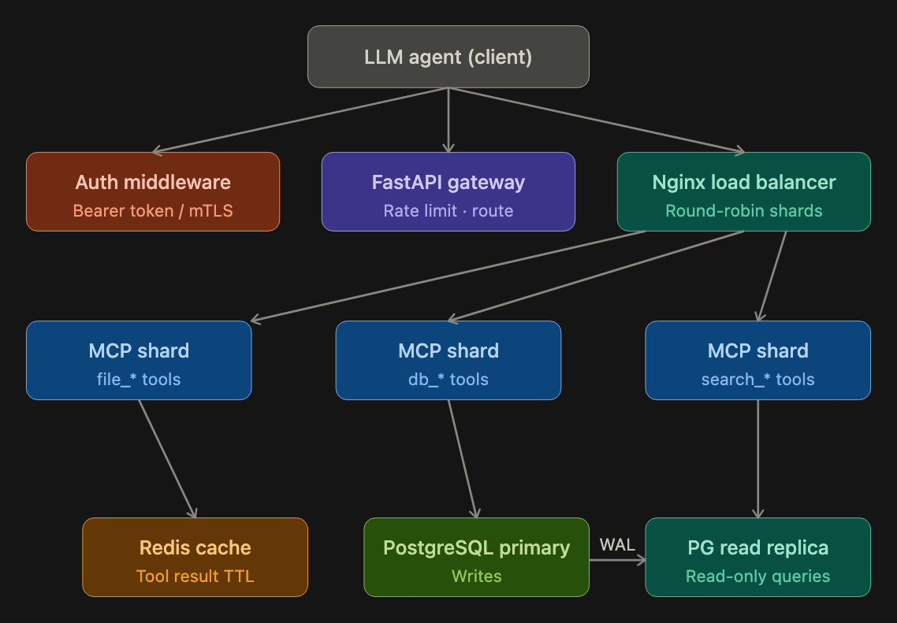

# MCP Tutorial — Chunk 4 / 8

## CHUNKS GENERATED: [4 / 8]

## ACTIVE CHUNK: [4 / 8]

## SECTIONS IN THIS CHUNK: [§07]

---

## §07. ADVANCED CONCEPTS

---

### 7.1 Security

---

#### Basic Protections

1. **Validate every tool input** before execution.
2. **Scope tool permissions** — expose only what the
   client needs.
3. **Use TLS** for all SSE and HTTP transport.
4. **Rotate secrets** (API keys, tokens) regularly.
5. **Log all tool calls** with structured logging for
   audit trails.

---

#### Advanced Protections

| Protection             | Mechanism                        |
|------------------------|----------------------------------|
| **OAuth 2.0**          | Token-based client auth          |
| **mTLS**               | Mutual TLS for server identity   |
| **Tool allow-listing** | Restrict callable tool names     |
| **Rate limiting**      | Per-client call throttling       |
| **Input sanitization** | Strip dangerous chars / payloads |
| **Secrets manager**    | Vault / AWS Secrets Manager      |

Here is the architecture overview for this chunk’s advanced topics:



---

#### Common Vulnerabilities and Fixes

| Vulnerability              | Fix                                      |
|----------------------------|------------------------------------------|
| **Prompt injection**       | Validate inputs; never execute raw LLM   |
|                            | output as system commands                |
| **Tool over-exposure**     | Expose minimum tool surface per client   |
| **Plaintext transport**    | Enforce TLS; reject plain HTTP           |
| **Hardcoded secrets**      | Use environment variables + secret store |
| **Unauthenticated server** | Require token / mTLS on every connection |

---

#### Security hardening — FastAPI gateway layer

```python
# src/gateway/middleware/auth.py

from fastapi import Request, HTTPException
from starlette.middleware.base import BaseHTTPMiddleware


class BearerAuthMiddleware(BaseHTTPMiddleware):
    """Reject any request missing a valid Bearer token."""

    def __init__(self, app, valid_token: str):
        super().__init__(app)
        # Store the expected token (loaded from env, not
        # hardcoded in source).
        self._valid_token = valid_token

    async def dispatch(self, request: Request, call_next):
        # Extract the Authorization header.
        auth = request.headers.get("Authorization", "")

        # Must be "Bearer <token>".
        if not auth.startswith("Bearer ") or
            auth[7:] != self._valid_token:
        raise HTTPException(
            status_code=401,
            detail="Unauthorized"
        )

        return await call_next(request)
```

```python
# src/gateway/main.py  (attach middleware)

import os
from fastapi import FastAPI
from .middleware.auth import BearerAuthMiddleware

app = FastAPI()

# Token loaded from environment — never hardcoded.
TOKEN = os.environ["GATEWAY_TOKEN"]
app.add_middleware(BearerAuthMiddleware, valid_token=TOKEN)
```

---

### 7.2 Scaling

---

#### Load Balancing

**Problem**: A single MCP server becomes a bottleneck
under high tool-call volume.

**Solution**: Run multiple MCP server replicas behind
an **Nginx** upstream.

```nginx
# nginx/nginx.conf

upstream mcp_servers {
    # Round-robin across three MCP server replicas.
    server mcp_server_1:8001;
    server mcp_server_2:8002;
    server mcp_server_3:8003;
}

server {
    listen 80;

    location /mcp/ {
        proxy_pass http://mcp_servers;
        proxy_http_version 1.1;

        # Required for SSE (Server-Sent Events):
        # disable buffering so events stream immediately.
        proxy_buffering off;
        proxy_cache off;

        # Keep the SSE connection alive.
        proxy_set_header Connection "";
        proxy_read_timeout 3600s;
    }
}
```

🔑 **Jargon**: **SSE** — Server-Sent Events; a
long-lived HTTP connection used by MCP to push
messages from server to client.

---

#### Caching Strategies

| Strategy          | What to cache      | Tool      |
|-------------------|--------------------|-----------|
| **Result cache**  | Deterministic tool | Redis     |
|                   | outputs (e.g. DB   |           |
|                   | lookups)           |           |
| **Schema cache**  | Tool list / JSON   | In-memory |
|                   | schema (rarely     | dict      |
|                   | changes)           |           |
| **Session cache** | Auth tokens per    | Redis TTL |
|                   | client             |           |

```python
# src/infrastructure/cache/redis_cache.py

import json
import redis.asyncio as aioredis


class RedisCache:
    """Async Redis wrapper for tool-result caching."""

    def __init__(self, url: str):
        # Create an async Redis connection pool.
        self._r = aioredis.from_url(url)

    async def get(self, key: str) -> dict | None:
        raw = await self._r.get(key)
        # Return None on cache miss.
        return json.loads(raw) if raw else None

    async def set(
            self, key: str, value: dict, ttl: int = 60
    ) -> None:
        # Serialize and store with a TTL in seconds.
        await self._r.set(key, json.dumps(value), ex=ttl)
```

---

#### Sharding

🔑 **Jargon**: **Sharding** — splitting data or load
across multiple nodes so no single node handles
everything.

For MCP servers:

- **By tool category**: one server handles
  `file_*` tools; another handles `db_*` tools.
- **By tenant**: each customer gets a dedicated
  MCP server instance.
- **By capability**: read-only vs write-capable
  servers separated for safety.

```
┌─────────────────────────────────────────┐
│              Nginx Gateway              │
└──────┬──────────────┬──────────────┬────┘
       │              │              │
┌──────▼─────┐ ┌──────▼─────┐ ┌─────▼──────┐
│  MCP Shard │ │  MCP Shard │ │  MCP Shard │
│  file_*    │ │   db_*     │ │  search_*  │
│  tools     │ │   tools    │ │  tools     │
└────────────┘ └────────────┘ └────────────┘
```

---

### 7.3 Reliability

---

#### Fault Tolerance

🔑 **Jargon**: **Fault tolerance** — system continues
operating when one component fails.

1. Wrap every tool call in `try/except`.
2. Return a structured error result instead of
   crashing.
3. Use **circuit breakers** to stop hammering a
   failing downstream service.

```python
# src/tools/fault_tolerant_tool.py

import structlog
from mcp.server import Server
from mcp.types import TextContent

log = structlog.get_logger()

# Global flag simulating a circuit breaker state.
_circuit_open = False


def register_resilient_tool(server: Server) -> None:
    @server.call_tool()
    async def query_db(name: str, arguments: dict):
        global _circuit_open

        if _circuit_open:
            # Circuit is open — fail fast, no DB call.
            log.warning("circuit_open", tool=name)
            return [TextContent(
                type="text",
                text="Service temporarily unavailable."
            )]

        try:
            result = await _do_db_query(arguments)
            return [TextContent(type="text", text=result)]

        except Exception as exc:
            # Log the error, trip the circuit.
            log.error("tool_error", tool=name, error=str(exc))
            _circuit_open = True
            return [TextContent(
                type="text",
                text=f"Error: {exc}"
            )]
```

---

#### Replication

🔑 **Jargon**: **Replication** — keeping identical
copies of data on multiple nodes so one can fail
without data loss.

For MCP:

- **PostgreSQL streaming replication**: primary
  node replicates WAL (write-ahead log) to
  standby nodes.
- **Read replicas**: route read-only tool calls
  (e.g. `search_records`) to replicas; write calls
  go to the primary.

```
┌───────────────────┐        WAL stream
│  PostgreSQL       │ ──────────────────►
│  Primary          │                    │
└───────────────────┘         ┌──────────▼────────┐
                               │  PostgreSQL        │
                               │  Standby (replica) │
                               └───────────────────┘
```

---

#### Recovery Strategies

| Strategy              | When                   | How                  |
|-----------------------|------------------------|----------------------|
| **Retry with          | Transient network      | Exponential backoff  |
| backoff**             | errors                 | (1s, 2s, 4s…)        |
| **Failover**          | Primary DB down        | Auto-promote standby |
| **Dead letter queue** | Tool call fails        | Re-queue in Redis /  |
|                       | repeatedly             | Celery DLQ           |
| **Health check**      | Detect dead server     | `/health` endpoint   |
|                       | before traffic hits it | in FastAPI           |

```python
# src/tools/retry.py

import asyncio


async def with_retry(fn, retries: int = 3):
    """Run fn() with exponential backoff on failure."""
    for attempt in range(retries):
        try:
            return await fn()
        except Exception as exc:
            if attempt == retries - 1:
                raise  # Final attempt — re-raise.
            wait = 2 ** attempt  # 1s, 2s, 4s ...
            await asyncio.sleep(wait)
```

---

### 7.4 Optimization

---

#### Performance Improvements

| Technique              | Impact                        |
|------------------------|-------------------------------|
| **Async I/O**          | Never block the event loop;   |
|                        | use `await` for all DB / HTTP |
| **Connection pooling** | Reuse DB connections via      |
|                        | `asyncpg` pool                |
| **Lazy schema load**   | Compute tool JSON Schema once |
|                        | at startup, not per request   |
| **Batch tool calls**   | Process multiple arguments in |
|                        | one DB round-trip             |
| **Response streaming** | Stream large tool results via |
|                        | SSE instead of buffering      |

---

#### Bottleneck Identification

1. **Add timing logs** around every tool call.
2. **Profile DB queries** with `EXPLAIN ANALYZE`
   in PostgreSQL.
3. **Monitor event loop lag** with `uvloop` and
   Prometheus metrics.
4. **Trace end-to-end** with OpenTelemetry spans.

```python
# src/tools/profiling.py

import time
import structlog

log = structlog.get_logger()


async def timed_tool(name: str, fn, *args, **kwargs):
    """Wrap any async tool call and log its duration."""
    start = time.perf_counter()
    result = await fn(*args, **kwargs)
    elapsed = time.perf_counter() - start
    log.info("tool_duration", tool=name, seconds=elapsed)
    return result
```

---

### 7.5 Trade-offs

| Approach               | Pros                  | Cons                     | When to use             |
|------------------------|-----------------------|--------------------------|-------------------------|
| **Stdio transport**    | Zero network setup;   | Single process only;     | Local dev; CLI tools;   |
|                        | simple debugging      | no horizontal scale      | desktop agents          |
| **SSE transport**      | HTTP native; easy     | Long-lived connections;  | Web services; multi-    |
|                        | to proxy/load balance | needs buffering care     | client deployments      |
| **Single MCP server**  | Simple; low ops       | Single point of failure; | Small teams; prototypes |
|                        | overhead              | hard to scale            |                         |
| **Sharded MCP          | Isolated failure      | Complex routing; higher  | Large prod systems;     |
| servers**              | domains; scales       | ops overhead             | multi-team platforms    |
| **In-process cache**   | Zero latency; no      | Lost on restart;         | Schema caching;         |
|                        | infra                 | not shared               | computed constants      |
| **Redis cache**        | Shared across         | Extra infra; network     | Tool-result caching;    |
|                        | replicas; persistent  | hop cost                 | session tokens          |
| **Sync tool handler**  | Simple code           | Blocks event loop;       | Never in production     |
|                        |                       | kills throughput         |                         |
| **Async tool handler** | Non-blocking; scales  | Requires async-aware     | All production code     |
|                        | with uvicorn workers  | libraries                |                         |

---

## 🔑 Jargon Summary — §07

| Term                    | Definition                                     |
|-------------------------|------------------------------------------------|
| **SSE**                 | Server-Sent Events; long-lived HTTP push       |
| **mTLS**                | Mutual TLS; both sides present certificates    |
| **Prompt injection**    | Attacker embeds commands in LLM input          |
| **Circuit breaker**     | Pattern that stops calls to a failing service  |
| **WAL**                 | Write-Ahead Log; PostgreSQL replication stream |
| **Sharding**            | Split load across nodes by category/tenant     |
| **Fault tolerance**     | System survives component failure              |
| **Dead letter queue**   | Queue for permanently failed messages          |
| **Connection pooling**  | Reuse open DB connections across requests      |
| **Exponential backoff** | Retry delays that double each attempt          |
| **OpenTelemetry**       | Vendor-neutral tracing / metrics standard      |

---

## STATUS

```
┌───────┬───────────────────┬──────────┐
│ Chunk │ Sections          │ Status   │
├───────┼───────────────────┼──────────┤
│   1   │ §00 – §02         │ DONE     │
│   2   │ §03 – §04         │ DONE     │
│   3   │ §05 – §06         │ DONE     │
│   4   │ §07               │ DONE ◄   │
│   5   │ §08 – §10         │ PENDING  │
│   6   │ §11 – §13         │ PENDING  │
│   7   │ §14 – §16         │ PENDING  │
│   8   │ §17 – §18         │ PENDING  │
└───────┴───────────────────┴──────────┘
```

**Next**: Send `chunk 5` to continue with
§08 Enterprise Usage, §09 Best Practices,
§10 Case Study.