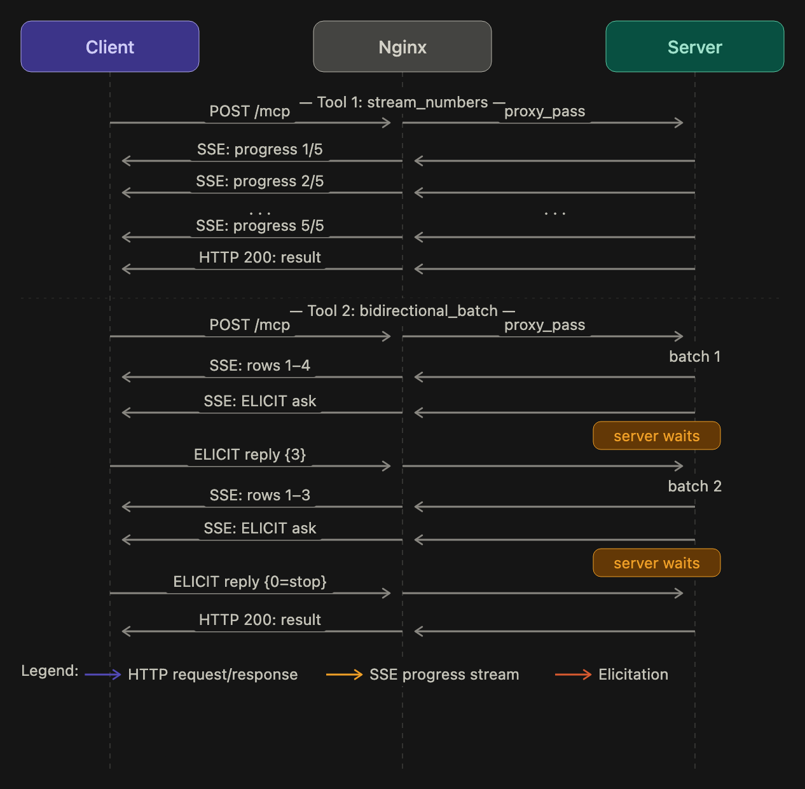

<!--
  CHUNKS GENERATED        : [4 / 8]
  ACTIVE CHUNK            : [4 / 8]
  SECTIONS IN THIS CHUNK  : [§05]
-->

## §05 BASIC EXAMPLE

---

### What This Example Does

- One MCP server, one MCP client, two tools.
- **Tool 1** (`stream_numbers`): server streams numbered
  chunks back to the client one at a time.
- **Tool 2** (`bidirectional_batch`): server sends a batch,
  asks the client a question mid-stream, client replies,
  server adjusts and continues.
- Everything runs in Docker via docker-compose.

Here is the flow diagram rendered inline:


---

### Project Structure

```
mcp-streamable-basic/
├── docker-compose.yml
├── .env
├── server/
│   ├── Dockerfile
│   ├── pyproject.toml
│   ├── src/
│   │   ├── main.py          # FastAPI + MCP server entry
│   │   ├── tools/
│   │   │   ├── __init__.py
│   │   │   ├── stream_tool.py      # Tool 1
│   │   │   └── bidirectional.py    # Tool 2
│   │   └── logging_config.py
├── client/
│   ├── Dockerfile
│   ├── pyproject.toml
│   └── src/
│       └── main.py          # MCP client entry
└── nginx/
    └── nginx.conf
```

---

### Step 1 — Environment File

```ini
# .env
MCP_SERVER_HOST = 0.0.0.0
MCP_SERVER_PORT = 8000
LOG_LEVEL = INFO
```

---

### Step 2 — Docker Compose

```yaml
# docker-compose.yml
version: "3.9"

services:

  # ── Nginx reverse proxy ──────────────────────────────
  nginx:
    image: nginx:alpine
    ports:
      - "80:80"            # expose port 80 to host
    volumes:
      - ./nginx/nginx.conf:/etc/nginx/nginx.conf:ro
    depends_on:
      - server

  # ── MCP Server ───────────────────────────────────────
  server:
    build: ./server
    env_file: .env
    expose:
      - "8000"             # internal only; nginx proxies it
    networks:
      - mcp-net

  # ── MCP Client ───────────────────────────────────────
  client:
    build: ./client
    environment:
      MCP_SERVER_URL: http://nginx/mcp   # through nginx
    depends_on:
      - nginx
    networks:
      - mcp-net

networks:
  mcp-net:
    driver: bridge
```

---

### Step 3 — Nginx Config

```nginx
# nginx/nginx.conf
events {
}

http {
    upstream mcp_backend {
        server server:8000;    # Docker service name
    }

    server {
        listen 80;

        location /mcp {
            proxy_pass http://mcp_backend;

            # Required for SSE / streaming responses
            proxy_buffering off;
            proxy_cache off;
            proxy_read_timeout 300s;

            # Pass original headers
            proxy_set_header Host $host;
            proxy_set_header X-Real-IP $remote_addr;
            proxy_set_header X-Forwarded-For $proxy_add_x_forwarded_for;
        }
    }
}
```

---

### Step 4 — Server: pyproject.toml

```toml
# server/pyproject.toml
[project]
name = "mcp-server"
version = "0.1.0"
requires-python = ">=3.12"

dependencies = [
    "mcp[cli]>=1.9.0", # MCP SDK with Streamable HTTP
    "fastapi>=0.115.0",
    "uvicorn[standard]>=0.32.0",
    "python-dotenv>=1.0.0",
]

[build-system]
requires = ["hatchling"]
build-backend = "hatchling.build"
```

---

### Step 5 — Server: Logging Config

```python
# server/src/logging_config.py
import logging, json, sys
from datetime import datetime, timezone


class JSONFormatter(logging.Formatter):
    """
    Structured JSON log formatter.
    Every log line is a valid JSON object.
    """

    def format(self, record: logging.LogRecord) -> str:
        # Build a structured log record dict
        log_record = {
            "timestamp": datetime.now(timezone.utc).isoformat(),
            "level": record.levelname,
            "logger": record.name,
            "message": record.getMessage(),
        }
        # Attach any extra fields passed via extra={...}
        if hasattr(record, "extra"):
            log_record.update(record.extra)
        return json.dumps(log_record)


def setup_logging(level: str = "INFO") -> None:
    """Configure root logger to emit JSON to stdout."""
    handler = logging.StreamHandler(sys.stdout)
    handler.setFormatter(JSONFormatter())

    logging.basicConfig(
        level=getattr(logging, level.upper(), logging.INFO),
        handlers=[handler],
    )
```

---

### Step 6 — Server: Tool 1 (stream_numbers)

```python
# server/src/tools/stream_tool.py
"""
Tool 1 — stream_numbers
-----------------------
Server streams N numbered chunks to the client.
Each chunk is a separate SSE event sent over the
same HTTP request (Streamable HTTP transport).

🔑 Jargon: SSE — Server-Sent Events: a one-way stream
           of text messages pushed from server → client
           over a persistent HTTP connection.
"""
import asyncio
import logging

from mcp.server.fastmcp import Context  # per-request context

logger = logging.getLogger(__name__)


async def stream_numbers(count: int, ctx: Context) -> str:
    """
    Stream `count` numbers back to the caller.

    Args:
        count: How many numbers to stream (1–20).
        ctx:   MCP request context — used to send
               progress notifications mid-stream.

    Returns:
        A final summary string after streaming completes.
    """
    # Clamp the input to a safe range
    count = max(1, min(count, 20))

    logger.info(
        "stream_numbers called",
        extra={"count": count},
    )

    for i in range(1, count + 1):
        # Send a progress notification to the client.
        # This triggers a streaming chunk over SSE.
        await ctx.report_progress(
            progress=i,  # current step
            total=count,  # total steps
            message=f"chunk {i}/{count}",  # human label
        )
        # Small delay so the stream is observable
        await asyncio.sleep(0.3)

    logger.info("stream_numbers complete", extra={"count": count})
    # Final return value — sent as the tool result
    return f"Streamed {count} chunks successfully."
```

---

### Step 7 — Server: Tool 2 (bidirectional_batch)

```python
# server/src/tools/bidirectional.py
"""
Tool 2 — bidirectional_batch
-----------------------------
Demonstrates multi-turn elicitation inside ONE tool call:

  1. Server processes a batch of rows.
  2. Server sends progress for each row.
  3. After the first batch, server ELICITS (asks) the
     client: continue or stop? And what batch size next?
  4. Client replies inside the same request.
  5. Server resumes with the new batch size — or stops.

🔑 Jargon: Elicitation — the MCP mechanism that lets a
           server ask a question to the client and WAIT
           for a reply, all within a single tool call.
"""
import asyncio
import logging
from typing import Any

from mcp.server.fastmcp import Context
from mcp.types import ElicitRequestParams, TextContent  # SDK types

logger = logging.getLogger(__name__)


async def bidirectional_batch(
        initial_batch_size: int,
        ctx: Context,
) -> str:
    """
    Process rows in configurable batches.
    After each batch, ask the client whether to continue.

    Args:
        initial_batch_size: Rows per batch (first batch).
        ctx:                MCP request context.

    Returns:
        Summary of all rows processed.
    """
    batch_size = max(1, min(initial_batch_size, 10))
    total_processed = 0
    batch_number = 0

    while True:
        batch_number += 1
        logger.info(
            "Starting batch",
            extra={
                "batch": batch_number,
                "size": batch_size,
            },
        )

        # ── Process one batch ────────────────────────
        for row in range(1, batch_size + 1):
            total_processed += 1
            await ctx.report_progress(
                progress=total_processed,
                total=None,  # total unknown — open-ended
                message=(
                    f"batch {batch_number}, "
                    f"row {row}/{batch_size} "
                    f"(total: {total_processed})"
                ),
            )
            await asyncio.sleep(0.2)  # simulate DB write

        # ── Elicit: ask the client what to do next ───
        # ElicitRequestParams defines the question schema.
        # The client MUST reply before the server continues.
        elicit_params = ElicitRequestParams(
            message=(
                f"Processed {total_processed} rows so far. "
                f"Continue? If yes, enter new batch size "
                f"(1-10) or 0 to stop."
            ),
            requestedSchema={
                # JSON Schema for the expected reply
                "type": "object",
                "properties": {
                    "batch_size": {
                        "type": "integer",
                        "minimum": 0,
                        "maximum": 10,
                        "description": "0 = stop, 1-10 = continue",
                    }
                },
                "required": ["batch_size"],
            },
        )

        # Send the elicit request and AWAIT the client reply
        response: Any = await ctx.elicit(elicit_params)

        # Parse client response
        if response is None:
            # Client did not respond — stop safely
            logger.warning("No elicitation response — stopping")
            break

        new_size: int = response.get("batch_size", 0)

        if new_size == 0:
            # Client chose to stop
            logger.info(
                "Client requested stop",
                extra={"total_processed": total_processed},
            )
            break

        # Update batch size for next iteration
        batch_size = new_size
        logger.info(
            "Client requested continue",
            extra={"new_batch_size": batch_size},
        )

    return (
        f"Bidirectional session complete. "
        f"Total rows processed: {total_processed}."
    )
```

---

### Step 8 — Server: Main Entry Point

```python
# server/src/main.py
"""
FastAPI application that mounts an MCP server
using the Streamable HTTP transport.

🔑 Jargon: Streamable HTTP Transport — an MCP transport
           where each tool call is a single HTTP POST
           that can stream SSE events back to the client
           before sending the final HTTP response.
"""
import os
import logging

from dotenv import load_dotenv
from fastapi import FastAPI
from mcp.server.fastmcp import FastMCP

# Import our two tools
from tools.stream_tool import stream_numbers
from tools.bidirectional import bidirectional_batch
from logging_config import setup_logging

# ── Bootstrap ────────────────────────────────────────────
load_dotenv()
setup_logging(os.getenv("LOG_LEVEL", "INFO"))
logger = logging.getLogger(__name__)

# ── Create the MCP server instance ───────────────────────
# FastMCP wraps a standard MCP server with a FastAPI-friendly
# interface. The name appears in MCP capability negotiation.
mcp = FastMCP(name="basic-mcp-server")


# ── Register tools ───────────────────────────────────────
# @mcp.tool() binds the function as an MCP tool.
# The docstring becomes the tool description sent to clients.

@mcp.tool(description="Stream N numbered chunks to the client.")
async def stream_numbers_tool(count: int, ctx) -> str:
    """Delegates to the stream_numbers implementation."""
    return await stream_numbers(count, ctx)


@mcp.tool(
    description=(
            "Process rows in batches with mid-stream elicitation. "
            "Server asks client whether to continue after each batch."
    )
)
async def bidirectional_batch_tool(
        initial_batch_size: int,
        ctx,
) -> str:
    """Delegates to the bidirectional_batch implementation."""
    return await bidirectional_batch(initial_batch_size, ctx)


# ── Mount MCP on FastAPI ─────────────────────────────────
# This creates a standard FastAPI app and mounts the MCP
# ASGI handler at /mcp, matching the nginx proxy_pass rule.
app: FastAPI = mcp.streamable_http_app(path="/mcp")

logger.info("MCP server ready", extra={"path": "/mcp"})
```

---

### Step 9 — Server: Dockerfile

```dockerfile
# server/Dockerfile
FROM python:3.12-slim

# Install uv (fast Python package manager)
RUN pip install --no-cache-dir uv

WORKDIR /app

# Copy dependency manifest first (layer cache optimisation)
COPY pyproject.toml .
# Install deps into the system Python (no venv inside Docker)
RUN uv pip install --system --no-cache .

# Copy source code
COPY src/ ./src/

# Run uvicorn with the FastAPI app exported from main.py
CMD ["uvicorn", "src.main:app",
     "--host", "0.0.0.0",
     "--port", "8000",
     "--log-level", "info"]
```

---

### Step 10 — Client: pyproject.toml

```toml
# client/pyproject.toml
[project]
name = "mcp-client"
version = "0.1.0"
requires-python = ">=3.12"

dependencies = [
    "mcp[cli]>=1.9.0",
    "httpx>=0.28.0",
    "python-dotenv>=1.0.0",
]

[build-system]
requires = ["hatchling"]
build-backend = "hatchling.build"
```

---

### Step 11 — Client: Main

```python
# client/src/main.py
"""
MCP Client — Streamable HTTP transport.

Connects to the MCP server, calls both tools, and:
  - Receives streamed progress events from Tool 1.
  - Participates in bidirectional elicitation in Tool 2.

🔑 Jargon: Elicitation handler — a callback registered on
           the client that is invoked when the server sends
           an elicit request during a tool call.
"""
import asyncio
import logging
import os
import json

from mcp import ClientSession
from mcp.client.streamable_http import streamablehttp_client
from mcp.types import ElicitRequest, ElicitResult

# ── Logging ──────────────────────────────────────────────
logging.basicConfig(
    level=logging.INFO,
    format="%(asctime)s [%(levelname)s] %(name)s — %(message)s",
)
logger = logging.getLogger("mcp-client")

# ── Config ───────────────────────────────────────────────
SERVER_URL = os.getenv("MCP_SERVER_URL", "http://localhost/mcp")


# ── Elicitation handler ──────────────────────────────────
async def handle_elicit(request: ElicitRequest) -> ElicitResult:
    """
    Called by the SDK whenever the server sends an
    elicit request during an active tool call.

    This simulates the client deciding to:
      - Continue with batch_size=3 on the first ask.
      - Stop (batch_size=0) on subsequent asks.
    """
    logger.info(
        "Elicitation received",
        extra={"message": request.params.message},
    )
    # Simple demo logic: always continue with size 3,
    # then stop when total > 6 (handled by returning 0).
    # In a real app this would prompt a human or an LLM.
    reply = {"batch_size": 3}
    logger.info("Elicitation reply", extra={"reply": reply})
    # ElicitResult wraps our JSON reply
    return ElicitResult(content=reply)


async def main() -> None:
    logger.info("Client starting", extra={"server": SERVER_URL})

    # ── Open a Streamable HTTP session ───────────────────
    # streamablehttp_client is the transport layer.
    # ClientSession is the MCP protocol layer on top.
    async with streamablehttp_client(SERVER_URL) as (
            read_stream,
            write_stream,
            _,  # unused: get_session_id callable
    ):
        async with ClientSession(
                read_stream,
                write_stream,
        ) as session:
            # Register the elicitation handler on the session
            session.elicit_handler = handle_elicit

            # ── Capability negotiation ───────────────────
            # initialize() exchanges protocol versions and
            # capability lists with the server.
            await session.initialize()
            logger.info("Session initialised")

            # ── List available tools ─────────────────────
            tools = await session.list_tools()
            logger.info(
                "Tools available",
                extra={"tools": [t.name for t in tools.tools]},
            )

            # ────────────────────────────────────────────
            # TOOL 1: stream_numbers
            # ────────────────────────────────────────────
            logger.info("Calling stream_numbers_tool (count=5)")

            # Progress events are delivered as notifications
            # on the read_stream between chunks; the SDK
            # surfaces them via the on_progress callback if set.
            result1 = await session.call_tool(
                "stream_numbers_tool",
                arguments={"count": 5},
            )
            logger.info(
                "stream_numbers_tool result",
                extra={"result": result1.content[0].text},
            )

            # ────────────────────────────────────────────
            # TOOL 2: bidirectional_batch
            # ────────────────────────────────────────────
            logger.info(
                "Calling bidirectional_batch_tool "
                "(initial_batch_size=4)"
            )
            result2 = await session.call_tool(
                "bidirectional_batch_tool",
                arguments={"initial_batch_size": 4},
            )
            logger.info(
                "bidirectional_batch_tool result",
                extra={"result": result2.content[0].text},
            )

    logger.info("Client done")


if __name__ == "__main__":
    asyncio.run(main())
```

---

### Step 12 — Client: Dockerfile

```dockerfile
# client/Dockerfile
FROM python:3.12-slim

RUN pip install --no-cache-dir uv

WORKDIR /app

COPY pyproject.toml .
RUN uv pip install --system --no-cache .

COPY src/ ./src/

# Run once and exit — not a long-running service
CMD ["python", "src/main.py"]
```

---

### Step 13 — Run and Verify

```bash
# 1. Build all images
docker compose build

# 2. Start nginx + server in background
docker compose up -d nginx server

# 3. Wait ~3 seconds for server to be ready
sleep 3

# 4. Run the client (streams output to terminal)
docker compose run --rm client
```

---

### Expected Output (client logs)

```
2025-01-01T12:00:00 [INFO] mcp-client — Client starting
  {"server": "http://nginx/mcp"}

2025-01-01T12:00:00 [INFO] mcp-client — Session initialised

2025-01-01T12:00:00 [INFO] mcp-client — Tools available
  {"tools": ["stream_numbers_tool", "bidirectional_batch_tool"]}

2025-01-01T12:00:00 [INFO] mcp-client — Calling stream_numbers_tool

  -- progress 1/5: chunk 1/5
  -- progress 2/5: chunk 2/5
  -- progress 3/5: chunk 3/5
  -- progress 4/5: chunk 4/5
  -- progress 5/5: chunk 5/5

2025-01-01T12:00:02 [INFO] mcp-client — stream_numbers_tool result
  {"result": "Streamed 5 chunks successfully."}

2025-01-01T12:00:02 [INFO] mcp-client — Calling bidirectional_batch_tool

  -- progress batch 1, row 1/4 (total: 1)
  -- progress batch 1, row 2/4 (total: 2)
  -- progress batch 1, row 3/4 (total: 3)
  -- progress batch 1, row 4/4 (total: 4)

  [ELICIT] "Processed 4 rows so far. Continue? ..."
  [REPLY ] {"batch_size": 3}

  -- progress batch 2, row 1/3 (total: 5)
  -- progress batch 2, row 2/3 (total: 6)
  -- progress batch 2, row 3/3 (total: 7)

  [ELICIT] "Processed 7 rows so far. Continue? ..."
  [REPLY ] {"batch_size": 0}

2025-01-01T12:00:06 [INFO] mcp-client — bidirectional_batch_tool result
  {"result":
    "Bidirectional session complete. Total rows processed: 7."}

2025-01-01T12:00:06 [INFO] mcp-client — Client done
```

---

### Step-by-Step Flow Diagram

```
CLIENT                   NGINX                SERVER
  │                        │                    │
  │── POST /mcp ──────────►│── proxy_pass ─────►│
  │   call: stream_numbers │                    │
  │                        │                    │  loop i=1..5
  │◄── SSE: progress 1/5 ──│◄── SSE chunk ──────│
  │◄── SSE: progress 2/5 ──│◄── SSE chunk ──────│
  │         ...            │         ...        │
  │◄── SSE: progress 5/5 ──│◄── SSE chunk ──────│
  │◄── HTTP 200: result ───│◄── final response ─│
  │                        │                    │
  │── POST /mcp ──────────►│── proxy_pass ─────►│
  │   call: bidirectional  │                    │
  │                        │                    │  batch 1
  │◄── SSE: row 1..4 ──────│◄── SSE chunks ─────│
  │                        │                    │
  │◄── SSE: ELICIT ────────│◄── elicit req ─────│  server waits
  │── ELICIT REPLY ───────►│── reply ──────────►│  server resumes
  │                        │                    │  batch 2
  │◄── SSE: row 1..3 ──────│◄── SSE chunks ─────│
  │                        │                    │
  │◄── SSE: ELICIT ────────│◄── elicit req ─────│  server waits
  │── ELICIT REPLY (0) ───►│── reply ──────────►│  server stops
  │◄── HTTP 200: result ───│◄── final response ─│
  │                        │                    │
```

---

### Key Points

- `FastMCP.streamable_http_app()` mounts MCP as an ASGI
  app at `/mcp` inside FastAPI.
- `ctx.report_progress()` sends SSE events mid-stream.
- `ctx.elicit()` pauses the tool and awaits a client reply.
- `session.elicit_handler` is a callback registered on the
  client that responds to server elicit requests.
- `proxy_buffering off` in nginx is required — without it,
  nginx buffers the entire response before forwarding,
  breaking the streaming behaviour.

---

### Summary of what was built:

| Component        | Role                             |
|------------------|----------------------------------|
| FastMCP          | MCP server + FastAPI mounting    |
| stream_tool.py   | Tool 1 — server→client streaming |
| bidirectional.py | Tool 2 — multi-turn elicitation  |
| nginx            | Reverse proxy with buffering off |
| ClientSession    | MCP protocol over HTTP transport |
| elicit_handler   | Client callback for server asks  |


---

| File                 | Purpose                                    |
|----------------------|--------------------------------------------|
| `stream_tool.py`     | Tool 1 — server streams N progress chunks  |
| `bidirectional.py`   | Tool 2 — elicit/reply loop inside one call |
| `main.py` (server)   | FastMCP + FastAPI mount at `/mcp`          |
| `main.py` (client)   | Session + elicit_handler + both tool calls |
| `nginx.conf`         | `proxy_buffering off` required for SSE     |
| `docker-compose.yml` | 3 containers: nginx, server, client        |

**3 things to memorize:**

1. `ctx.report_progress()` sends SSE chunks mid-tool.
2. `ctx.elicit()` pauses the server and awaits a client reply.
3. `proxy_buffering off` in nginx is **not optional** — buffering breaks
   streaming.

Type **"chunk 5"** to continue to §06 Intermediate Level.